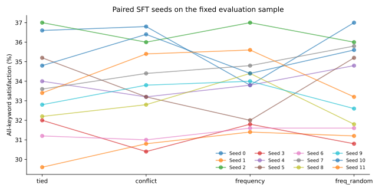
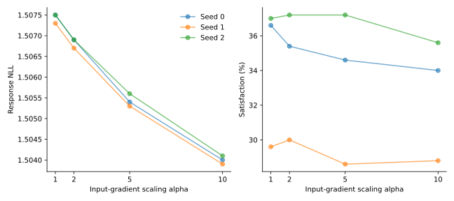

# Gradient-Guided Selective Untying in Small Language Models

**A controlled study with 12 paired fine-tuning seeds.** Does giving only the
most gradient-conflicted tokens an independent output offset improve a small
language model's keyword-constrained story generation?

**Result:** conflict-guided selection does not meet the project's success rule.
Its satisfaction difference is **−0.03 percentage points versus frequency**
and **−0.12 points versus frequency-matched random**, with worse reference NLL
than tied. This is a conditional null finding, not a universal claim about untying.

**Evaluation caveat:** the audit found 129/500 evaluation stories in the official
pretraining split. A post-hoc analysis of the remaining 371 stories reaches the
same qualitative conclusion; details are below. Near duplicates were not checked.

**Team:** Commit and Pray — Sanjith Suresh Kumar, Shriyadita Mohanty, Sindhu K S,
Greeshma G. Course: UE24AM342AA1, Advanced Foundations in Machine Learning.

## Contents

- [Method](#method)
- [Main results: 12 seeds](#main-results-12-seeds)
- [Exploratory results: 3 seeds](#exploratory-results-3-seeds)
- [Install and analyze](#install-and-analyze)
- [Data and checkpoint](#data-and-checkpoint)
- [Run the pipeline](#run-the-pipeline)
- [Artifacts and resume](#artifacts-and-resume)
- [Evaluation, overlap and limitations](#evaluation-overlap-and-limitations)
- [Repository guide](#repository-guide)
- [References](#references)

## Method

Weight tying shares a token embedding matrix between input lookup and output
prediction. We split each row's loss gradient into input and output contributions:

~~~text
g_total[i] = g_input[i] + g_output[i]
conflict[i] = -cosine(g_input[i], g_output[i])

Input row:  E[i]
Output row: E[i] + delta[i] if selected, otherwise E[i]
~~~

A second gradient pass detaches the input embedding output to isolate the output
contribution. Eligible rows have training frequency >=20, are non-special tokens,
and have nonzero gradient norms. Calibration yields 6,341 eligible tokens.
At most 400 rows, capped at 10% of eligible rows, receive zero-initialized offsets.

All selective baselines use the same eligible pool and parameter budget:
**400 × 384 = 153,600 added parameters**. All model parameters are fine-tuned;
this is not frozen-backbone, offsets-only training. Full untying adds 3,072,000
parameters and is a separate, larger-budget comparison.

The project's success criterion requires a mean all-keyword satisfaction gain of
**at least 2 percentage points over both frequency and matched random**, with
**no mean response-NLL degradation versus tied**. The 12-seed extension followed
inspection of the initial three-seed results. Keyword recall was added as a
secondary metric. The whole analysis is not claimed to be preregistered.

## Main results: 12 seeds

Source: [results_v2.json](results_v2.json). **48 runs: four methods × seeds 0–11**,
each evaluated on the same 500 qualifying prompts. Values are means over seeds.

| Method | Seeds | All-keyword satisfaction ↑ | Macro keyword recall ↑ | Response NLL ↓ |
|---|---:|---:|---:|---:|
| Tied | 12 | 33.53% | 70.48% | 1.50832 |
| Conflict-selected | 12 | 33.68% | 70.54% | 1.50973 |
| Frequency-selected | 12 | 33.72% | 70.44% | 1.50801 |
| Frequency-matched random | 12 | 33.80% | 70.32% | 1.50925 |

### Paired uncertainty

Runs are paired by seed. The intervals below are approximate 95% Student-t
intervals over the 12 seed-level differences, calculated from rounded records.

| Comparison | Satisfaction difference | Paired 95% interval |
|---|---:|---:|
| Conflict − frequency | −0.03 pp | [−0.92, +0.85] pp |
| Conflict − matched random | −0.12 pp | [−0.91, +0.67] pp |
| Conflict − tied | +0.15 pp | [−0.66, +0.96] pp |

Both baseline intervals exclude the targeted +2pp benefit in this setting.
Conflict also increases NLL versus tied by **0.001408**, with paired 95% interval
**[0.001321, 0.001496]**. All three success conditions fail. Recall differences
are small and their paired intervals include zero.

These intervals describe SFT-seed variation conditional on **one pretrained
checkpoint, one fixed evaluation sample, one calibration and one random-selected
token set**. They do not measure variation across pretraining runs, new prompts
or independent random token selections. Twelve repetitions of the same 500
prompts are not 6,000 independent prompts.

Seeds 0–2 exactly reproduce the original satisfaction and NLL for all four methods.
All 48 runs contain 500 missing-word records, and empty-list counts agree with
reported satisfaction. See [the main report](reports/main/RESULTS.md),
[machine-readable statistics](reports/main/summary.json), and
[methods CSV](reports/main/methods.csv).

## Exploratory results: 3 seeds

The original comparison contains seeds 0–2. These results must remain separate
from the expanded four-method experiment.

| Method | Seeds | Satisfaction ↑ | Response NLL ↓ |
|---|---:|---:|---:|
| Tied | 3 | 34.40% | 1.50743 |
| Full untying | 3 | 33.07% | 1.50480 |
| Conflict | 3 | 34.53% | 1.50883 |
| Frequency | 3 | 34.07% | 1.50707 |
| Frequency-matched random | 3 | 34.73% | 1.50843 |
| Gradient norm | 3 | 34.00% | 1.50653 |

Source: [results.json](results.json). Full untying has a larger parameter budget;
its lower NLL does not establish better generated-story coherence.

### Input-gradient scaling

This tied-model intervention applies
~~~text
embedding_gradient = alpha * g_input + g_output
~~~
during **SFT**, before clipping and AdamW. It is not a reproduction of the full
pretraining intervention studied in the motivating paper.

| Alpha | Seeds | Satisfaction ↑ | Response NLL ↓ |
|---|---:|---:|---:|
| 1, tied | 3 | 34.40% | 1.50743 |
| 2 | 3 | 34.20% | 1.50683 |
| 5 | 3 | 33.47% | 1.50543 |
| 10 | 3 | 32.80% | 1.50400 |

Mean NLL and mean satisfaction both decrease as alpha grows. For alpha=10 versus
tied, satisfaction changes by −1.60pp with paired 95% interval [−3.88, +0.68]pp.
This is an exploratory **response-NLL / keyword-satisfaction pattern**, not a
proven human-fluency trade-off. A trend in means need not hold for each seed.
The committed scaling file contains three seeds per alpha.

Sources: [results_gradscale.json](results_gradscale.json) and
[exploratory report](reports/exploratory/RESULTS.md).

## Install and analyze

The historical environment uses **Python 3.13**, PyTorch 2.14.1+cu130 and an
RTX 4060 Laptop GPU with 8 GB VRAM. [requirements.txt](requirements.txt) records
the author's package versions. Analysis dependencies are separate.

~~~bash
python -m venv .venv
source .venv/bin/activate
# Windows PowerShell instead: .venv\Scripts\Activate.ps1
python -m pip install -r requirements-analysis.txt
python -m unittest discover -v
~~~

For GPU runs, install the CUDA-enabled build matching the pinned PyTorch version
using the [official PyTorch installer](https://pytorch.org/get-started/locally/).
Check the actual environment before training:

~~~bash
python -c "import torch; print(torch.__version__); print(torch.cuda.is_available())"
~~~

CPU training is supported, but full experiments are much slower. Local CPU checks
used Python 3.14 with slightly different NumPy/tqdm patch versions; actual versions
and verification limits are recorded in [VALIDATION.md](VALIDATION.md).

**No GPU, dataset or checkpoint download is needed to rebuild tables and plots:**

~~~bash
python report_results.py --output reports/main
python report_results.py --results results.json --scaling results_gradscale.json --output reports/exploratory
python analyze.py
~~~

Result reports include byte hashes and canonical-JSON hashes; newline formatting
can change byte hashes across checkouts without changing results.
Analysis uses paired seed differences, sample SD and tie-aware Spearman ranks.
See [calibration descriptions](reports/calibration-analysis.txt). Low correlation
with frequency or low selector overlap does not prove causal relevance or stability.

## Data and checkpoint

Official sources:

- [TinyStories](https://huggingface.co/datasets/roneneldan/TinyStories): the
  dataset's train/validation splits, exported to single-column CSVs with a text
  header. The author confirmed **2,119,719 training rows**.
- [TinyStoriesInstruct](https://huggingface.co/datasets/roneneldan/TinyStoriesInstruct):
  TinyStories-Instruct-train.txt / TinyStories-Instruct-valid.txt for calibration,
  fine-tuning and evaluation. The training file is approximately 2.7 GB.

~~~bash
python download_data.py                  # both datasets
python download_data.py --only instruct  # calibration / SFT only
~~~

New downloads resolve immutable source commits and record checksums in
dataset/sources.json. Pass --stories_revision and --instruct_revision to repeat
recorded revisions. Existing files are skipped; skipping a legacy file does not
establish its provenance. Exact historical source revisions were not recorded
during the experiments. Respect source licenses and attribution.

### Original pretrained checkpoint

Download the author-supplied model:
**[ishrya/selective-untying/latest.pt](https://huggingface.co/ishrya/selective-untying/resolve/main/latest.pt)**.
The approximately 166 MB file includes optimizer state.

~~~bash
python -c "from pathlib import Path; import urllib.request; Path('checkpoints').mkdir(exist_ok=True); urllib.request.urlretrieve('https://huggingface.co/ishrya/selective-untying/resolve/main/latest.pt', 'checkpoints/latest.pt')"
python verify_checkpoint.py checkpoints/latest.pt
~~~

Expected original-checkpoint SHA-256:

~~~text
b18fabcfc8430769487a3bb96d1e8b83c7eb49510145eba6fecb300e3bd270a0
~~~

The supplied checkpoint passes strict model loading and records step **28,503**
and validation loss **1.4663459479808807**, corresponding to perplexity **4.33337**.
The received tokenizer is structurally identical to the repository tokenizer;
text formatting can change byte hashes. These checks establish structure and
metadata consistency, not independent reproduction of all scores.
See [checkpoint verification](reports/checkpoint-verification.json).

## Run the pipeline

### Configuration

| Setting | Value |
|---|---|
| Architecture | Decoder-only, 6 pre-LN blocks, width 384, 6 attention heads |
| MLP / positions | GELU, FF width 1536; learned positions |
| Vocabulary / context | 8,000 byte-level BPE tokens / 256 tokens |
| Tied / fully untied parameters | 13,817,856 / 16,889,856 |
| Pretraining | One pass, approximately 470M tokens, 28,503 updates |
| Pretraining optimizer | AdamW, lr 6e-4, 500 warmup steps, cosine decay, weight decay 0.1 |
| Pretraining batch | 32 sequences × 2 accumulation steps × 256 tokens |
| Calibration | Up to 10M story tokens; frequency >=20; 6,341 eligible tokens |
| Selective budget | At most 400 rows and 10% of eligible rows |
| SFT | First 20,000 qualifying examples; 1,000 updates; batch 16 |
| SFT optimizer | AdamW, lr 1e-4, 50 warmup steps, minimum lr 1e-5, weight decay 0.1 |
| Evaluation | First 500 qualifying validation examples; greedy decoding |

### Smoke test

Keep short runs separate from full experiment results:

~~~bash
python sft.py --methods tied --seeds 0 --max_steps 20 --eval_examples 20 --out runs/smoke/results.json --artifact_dir runs/smoke/artifacts
~~~

### Calibration and fine-tuning

~~~bash
# Optional: train NEW weights; not the historical checkpoint.
python train.py --ckpt_dir checkpoints/new

# Original downloaded checkpoint is the default for calibration and SFT.
python calibrate.py --out runs/calibration.json

# Main comparison: 4 methods x 12 paired seeds.
python sft.py --calibration runs/calibration.json --methods tied conflict frequency freq_random --seeds 0 1 2 3 4 5 6 7 8 9 10 11

# Original six-method exploratory setup: separate outputs.
python sft.py --calibration runs/calibration.json --out runs/exploratory/results.json --artifact_dir runs/exploratory/artifacts

# Scaling; alpha=1 checks agreement with ordinary tied SFT.
python sft_gradscale.py --alphas 1 2 5 10
~~~

For newly pretrained weights, pass --ckpt_path checkpoints/new/latest.pt to
calibration and both SFT scripts, and choose new result directories. Never mix
checkpoints within a paired comparison.

The committed calibration.json predates hash manifests. Explicit
--allow_legacy_calibration permits reuse, with a warning. The author reports
recalibration reproduced the exact same 400 IDs. New traceable calibration must
match the checkpoint, tokenizer and training-data hashes used for the run.

### Compute

Author-reported historical timings on the RTX 4060 Laptop GPU:

- Pretraining: approximately 78 minutes plus 8 minutes preparation.
- Calibration: **392 seconds**.
- SFT/evaluation: approximately 200 seconds per run.
- Forty-eight main runs: approximately 160 minutes at that rate, excluding setup
  and interruptions. Timings are not portable hardware benchmarks.

## Artifacts and resume

New runs default to runs/sft and runs/gradscale, preserving committed historical
results. They record:

- unrounded aggregate satisfaction, macro recall, NLL and per-prompt missing words;
- generated response text/IDs, prompt/reference IDs and requested words;
- per-example NLL sums/counts, output length, EOS and context-sliding flags;
- final model weights, architecture, method/seed and selected token IDs;
- source/input hashes, settings, package versions, device and CUDA version.

JSON and final SFT-weight writes use atomic replacement. Completed runs are skipped
only with matching manifests. Changed settings, inputs, code or environment
require new --out and --artifact_dir paths. The hardened scripts reject silent
resumption of legacy result files without manifests.

Interrupted individual SFT runs restart from pretrained weights, not mid-step.
New pretraining checkpoints preserve optimizer, data order and RNG state for
train.py --resume under the original schedule. Unverified token caches require
new paths. See [VALIDATION.md](VALIDATION.md) for checks and limits.

## Evaluation, overlap and limitations

- **Satisfaction:** fraction of generated responses containing every requested
  word under case-insensitive whole-word matching.
- **Macro recall:** mean fraction of requested words present per response.
- **Response NLL:** token-weighted reference-response loss, including EOS,
  excluding prompt/padding targets.
- References must contain all requested words and fit with the prompt in 256 tokens.
- Generation is greedy, stopping at EOS or 256 new tokens, with a sliding 256-token
  context. Long generations can lose the instruction from context.
- Calibration uses packed story-only gradients; SFT uses prompted response-only loss.
- One checkpoint, one task, one evaluation prefix and one random token selection
  limit generalization. Hyperparameters and selector stability were not exhaustively tested.

**Human coherence/integration ratings have not been conducted or supplied.**
No human scores, demonstrated fluency gains or semantic-compliance claims are
made. NLL and keyword presence do not establish generated-story coherence.
See [evaluation definitions and claim boundaries](docs/EVALUATION.md).

### Training/evaluation overlap

~~~bash
python audit_overlap.py
python report_overlap.py
~~~

**Completed audit:** all 2,119,719 official pretraining records were scanned.
**129/500 evaluation stories (25.8%) matched pretraining**, while **0/500** matched
SFT training and **0/500** matched calibration. All 500 evaluation stories were
unique. Reconstructed prompts passed all missing-word/recall alignment checks.

The remaining **371 prompts** give this post-hoc sensitivity analysis (12 seeds):

| Method | Satisfaction | Macro recall |
|---|---:|---:|
| Tied | 33.87% | 70.71% |
| Conflict | 34.05% | 70.81% |
| Frequency | 34.14% | 70.66% |
| Matched random | 34.14% | 70.54% |

Conflict − frequency is −0.09pp [−1.34, +1.16]; conflict − matched random is
−0.09pp [−1.21, +1.03]. The +2pp gain remains outside both paired 95% intervals.
This is a **post-hoc fixed-subset sensitivity analysis**, not a new independent
test set or proof that contamination is harmless. Subset NLL is unavailable.
See [the non-overlap report](reports/NONOVERLAP.md).

The audit reconstructs the 500 evaluation examples, first 20,000 qualifying SFT
examples and 10M-token calibration prefix, then scans the official TinyStories
training split. Source revisions, matched indices and remaining-subset lexical
metrics are recorded in [reports/overlap-audit.json](reports/overlap-audit.json).
It checks case/whitespace-normalized exact stories, not near duplicates or semantic
similarity. Historical results are preserved; any clean-subset analysis is labeled
separately. Aggregate records cannot reconstruct subset NLL.

## Repository guide

| Path | Purpose |
|---|---|
| transformer_architecture.py | Tied / full / selective-offset model |
| download_data.py | Official split download, CSV conversion and source hashes |
| train.py | Pretraining, token-cache checks, training-state resume |
| calibrate.py / analyze.py | Gradient decomposition, selection and descriptions |
| sft.py / sft_gradscale.py | SFT, generation, metrics and saved models |
| common.py / reproducibility.py | Parsing, strict loading, provenance and atomic writes |
| verify_checkpoint.py | Checkpoint validation and checksum manifest |
| report_results.py | Tables, paired statistics and figures |
| audit_overlap.py / report_overlap.py | Exact-story overlap audit and subset analysis |
| results_v2.json | Main four-method, 12-seed results |
| results.json / results_gradscale.json | Original three-seed exploratory results |
| reports/main / reports/exploratory | Rebuilt statistics, tables and plots |
| docs/EVALUATION.md | Metric definitions and human-evaluation status |
| test_reproducibility.py / test_analysis.py | Correctness and analysis checks |
| .github/workflows/checks.yml | Automated CPU checks and report generation |
| findings.txt | Updated conclusions |
| VALIDATION.md | Verification evidence and limits |

Paper, final presentation and video are prepared separately by the team.
The one-page proposal PDF is an earlier project artifact, not the final report.
No project-wide software license has been selected by the authors; public access
alone does not grant an open-source license. Dataset terms belong to their sources.

## References

- Press and Wolf, [Using the Output Embedding to Improve Language Models](https://arxiv.org/abs/1608.05859).
- Inan, Khosravi and Socher, [Tying Word Vectors and Word Classifiers](https://arxiv.org/abs/1611.01462).
- Lopardo et al., [Weight Tying Biases Token Embeddings Towards the Output Space](https://arxiv.org/abs/2603.26663).
- Eldan and Li, [TinyStories: How Small Can Language Models Be and Still Speak Coherent English?](https://arxiv.org/abs/2305.07759).
