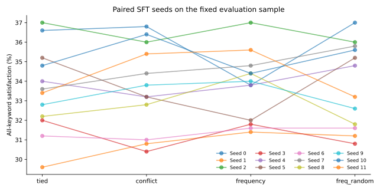

# Gradient-Guided Selective Untying in Small Language Models

Team Commit and Pray · Advanced Foundations in Machine Learning (UE24AM342AA1)

Small language models save parameters by sharing one embedding table for reading tokens and predicting them. Those two roles can push the same token vector in different directions. We tested whether giving the 400 most conflicted tokens their own output offsets helps the model write stories containing requested words.

Across 12 paired fine-tuning seeds, conflict selection fell short of our two-percentage-point target against both selection baselines. The conclusion held on the subset of evaluation stories with no normalized exact match in the pretraining split.

## Quick start

```bash
git clone https://github.com/SanjithSK29/Selective-Untying.git
cd Selective-Untying
python -m venv .venv
source .venv/bin/activate
# On Windows PowerShell, activate with .venv\Scripts\Activate.ps1
python -m pip install -r requirements-analysis.txt
```

We used Python 3.13 and PyTorch 2.14.1 with CUDA 13.0 on an RTX 4060 Laptop GPU with 8 GB VRAM. For GPU runs, install the matching CUDA build using the [PyTorch installation instructions](https://pytorch.org/get-started/locally/) and check it with `python -c "import torch; print(torch.__version__, torch.cuda.is_available())"`.

**Inspect the results on CPU.** These commands use the committed results and calibration files. They require no datasets or checkpoint.

```bash
python -m unittest discover -v
python report_results.py --output runs/reports/main
python report_results.py --results results.json --scaling results_gradscale.json --output runs/reports/exploratory
python analyze.py
python report_overlap.py
```

**Run a smoke test.** Download the instruction data (about 2.7 GB) and our original checkpoint (about 166 MB, including optimizer state).

```bash
python download_data.py --only instruct
python -c "from pathlib import Path; from urllib.request import urlretrieve; Path('checkpoints').mkdir(exist_ok=True); urlretrieve('https://huggingface.co/ishrya/selective-untying/resolve/main/latest.pt', 'checkpoints/latest.pt')"
python verify_checkpoint.py checkpoints/latest.pt
python -c "import json, sys; from pathlib import Path; got=json.loads(Path('checkpoint-manifest.json').read_text())['checkpoint_sha256']; sys.exit(0 if got == 'b18fabcfc8430769487a3bb96d1e8b83c7eb49510145eba6fecb300e3bd270a0' else 'Checkpoint checksum mismatch: ' + got)"
python sft.py --methods tied --seeds 0 --max_steps 20 --eval_examples 20 --out runs/quickstart/results.json --artifact_dir runs/quickstart/artifacts
```

Continue to training only if checkpoint verification and the checksum comparison both succeed. The checkpoint records 28,503 pretraining updates and validation perplexity 4.33. We verified its structure and checked that the supplied tokenizer matches the repository copy. [Checkpoint metadata](reports/checkpoint-verification.json)

## Method

For each token row, we estimate the input and output contributions to its embedding gradient. A backward pass gives their sum. A second pass with the input lookup detached isolates the output gradient. We recover the input contribution by subtraction and score disagreement with negative cosine similarity.

Calibration uses about 10 million story tokens. We exclude special tokens, rows with frequency below 20, and rows with a zero gradient norm. We give 400 of the 6,341 eligible rows a zero-initialized output offset, adding **153,600 parameters**. The input row stays shared, and all model parameters are fine-tuned. The two budget-matched controls pick the most frequent eligible rows or sample rows to match the conflict selection's frequency bins.

| Setting | Value |
|---|---|
| Model | Six decoder blocks, width 384, six attention heads, context length 256 |
| Vocabulary | 8,000 byte-level BPE tokens |
| Parameters | 13,817,856 tied, 16,889,856 fully untied |
| Pretraining | TinyStories, about 470M tokens over 28,503 updates |
| Fine-tuning | First 20,000 qualifying TinyStoriesInstruct examples, 1,000 updates, batch size 16, peak learning rate 0.0001 |
| Evaluation | First 500 qualifying validation prompts, greedy decoding |

Satisfaction is the fraction of generated responses containing all requested words under case-insensitive whole-word matching. Macro recall averages the fraction of requested words present per prompt. Response negative log-likelihood (NLL) measures prediction of the reference response tokens given the prompt, including EOS and excluding prompt and padding tokens.

## Main results

Each method uses seeds 0–11 with matching minibatch order for the same seed. All 48 runs use the same checkpoint and evaluation prompts. Seeds 0–2 reproduce the original satisfaction and NLL values for these four methods. [Per-seed records](results_v2.json)

| Method | Satisfaction ↑ | Macro recall ↑ | Response NLL ↓ |
|---|---:|---:|---:|
| Tied | 33.53% | 70.48% | 1.50832 |
| Conflict | 33.68% | 70.54% | 1.50973 |
| Frequency | 33.72% | 70.44% | 1.50801 |
| Frequency-matched random | 33.80% | 70.32% | 1.50925 |

Our success criterion required at least a two-percentage-point gain over both selection baselines and no increase in mean response NLL relative to the tied model. Conflict selection missed all three conditions.

| Conflict minus comparator | Satisfaction change (percentage points) | Paired 95% interval |
|---|---:|---:|
| Frequency | −0.03 | [−0.92, +0.85] |
| Frequency-matched random | −0.12 | [−0.91, +0.67] |
| Tied | +0.15 | [−0.66, +0.96] |

Conflict selection raised NLL by **0.001408** versus the tied baseline (paired 95% interval [0.001321, 0.001496]). The intervals use paired Student t calculations and reflect variation across fine-tuning seeds for the fixed checkpoint, calibration sample, evaluation prompts, and random token set. [Statistical report](reports/main/RESULTS.md)



### Training-data overlap

We scanned all 2,119,719 records in the official TinyStories training split. Of the 500 evaluation stories, 129 had a normalized exact pretraining match. None matched the reconstructed fine-tuning or calibration prefixes. On the remaining 371 prompts, conflict selection was 0.09 percentage points below each selection baseline. The paired intervals were [−1.34, +1.16] against frequency and [−1.21, +1.03] against matched random. Both still exclude the two-point target.

We defined this subset after the main runs and recomputed lexical scores from the saved keyword records. The audit checks case-folded, whitespace-normalized exact matches. Near duplicates may remain. Subset NLL requires per-prompt losses, which the historical runs did not save. [Audit and subset results](reports/NONOVERLAP.md)

## Exploratory results

The original three-seed comparison also included full untying (33.07% satisfaction, 1.50480 NLL) and selection by gradient norm (34.00%, 1.50653). Their matched tied baseline was 34.40% and 1.50743. Full untying adds 3,072,000 parameters. [Original records](results.json)

### Input-gradient scaling

We keep the embeddings tied and use `alpha * g_input + g_output` for their gradient before clipping and the AdamW update. The table shows the original sweep on seeds 0–2.

| Alpha | Satisfaction ↑ | Response NLL ↓ |
|---|---:|---:|
| 1 (tied) | 34.40% | 1.50743 |
| 2 | 34.20% | 1.50683 |
| 5 | 33.47% | 1.50543 |
| 10 | 32.80% | 1.50400 |

The scaling records now include three seeds each at alpha 2 and 5 and 12 at alpha 10. Across 12 matched seeds, alpha 10 changed NLL by **−0.00332** (paired 95% interval [−0.00349, −0.00314]) and satisfaction by **−0.82 percentage points** ([−1.68, +0.05]). The committed exploratory report shows the original three-seed snapshot. The report command in Quick start reads the expanded scaling file. [Scaling records](results_gradscale.json) · [Original report](reports/exploratory/RESULTS.md)

### Early-only scaling and output damping

Scaling the input gradient by ten for the first 500 of 1,000 fine-tuning steps lowered response NLL by about **0.0032** versus tying, close to **0.0033** for full-run scaling. Satisfaction changed by **−0.32 percentage points** (paired 95% interval [−1.21, +0.57]). Compared directly with full-run scaling, the early schedule scored 0.50 points higher on average, with uncertainty about the advantage. [Early-only scaling runs](hypotheses/H5_early_rebalance/results.json)

Output damping at gamma 0.1 lowered NLL by about **0.0042** and satisfaction by **1.47 percentage points** versus tying. Both scaling and damping use global gradient clipping. The comparison changes the magnitude of the embedding gradient relative to the other gradients, so it does not isolate clipping's contribution. [Damping runs](hypotheses/H3_output_damping/results.json) · [Screening overview](hypotheses/README.md)

These results concern reference prediction and keyword use on this task. We did not collect blinded human ratings of story coherence or keyword integration.

## Run the full pipeline

The official sources are [TinyStories](https://huggingface.co/datasets/roneneldan/TinyStories) for pretraining and [TinyStoriesInstruct](https://huggingface.co/datasets/roneneldan/TinyStoriesInstruct) for calibration, fine-tuning, and evaluation. The downloader records resolved dataset revisions and hashes for newly downloaded or generated files in `dataset/sources.json`. Use `--stories_revision` and `--instruct_revision` to repeat a recorded revision. The original runs did not record exact source revisions.

**Use the released checkpoint.** Complete Quick start first, then run from the repository root.

```bash
python calibrate.py --out runs/calibration.json
python sft.py --calibration runs/calibration.json --methods tied conflict frequency freq_random --seeds 0 1 2 3 4 5 6 7 8 9 10 11
python sft.py --calibration runs/calibration.json --out runs/original-comparison/results.json --artifact_dir runs/original-comparison/artifacts
python sft_gradscale.py --alphas 2 5 10 --seeds 0 1 2
python sft_gradscale.py --alphas 10 --seeds 0 1 2 3 4 5 6 7 8 9 10 11
```

**Train a new checkpoint.** This route downloads both datasets and uses the repository tokenizer. Calibration and downstream training must point to the new checkpoint.

```bash
python download_data.py
python train.py --ckpt_dir checkpoints/new
python calibrate.py --ckpt_path checkpoints/new/latest.pt --out runs/new/calibration.json
python sft.py --ckpt_path checkpoints/new/latest.pt --calibration runs/new/calibration.json --methods tied conflict frequency freq_random --seeds 0 1 2 3 4 5 6 7 8 9 10 11 --out runs/new/sft/results.json --artifact_dir runs/new/sft/artifacts
```

**Run the follow-ups.** These commands use the released checkpoint and the instruction data. Run them from the repository root with the environment above active.

```bash
python hypotheses/screen.py --configs early_rebalance:10@250 early_rebalance:10@500 --seeds 0 1 2 3 4 5 6 7 8 9 10 11 --out runs/h5/results.json
python hypotheses/screen.py --configs output_damping:0.5 output_damping:0.1 --seeds 0 1 2 3 4 5 6 7 8 9 10 11 --out runs/h3/results.json
```

To rerun the overlap audit, use `python audit_overlap.py` followed by `python report_overlap.py`. The audit streams the official training data and writes the matched evaluation indices and source revisions.

### Run time and outputs

On our RTX 4060 Laptop GPU, pretraining took about 78 minutes plus 8 minutes for preparation. Calibration took 392 seconds. The original SFT logs show about 200–226 seconds per run, including evaluation. At 200 seconds per run, the 48-run comparison would take about 160 minutes before setup and interruptions. [SFT log](sft.log)

The main fine-tuning scripts save run settings, input and source hashes, final weights, generated responses, and per-example metrics. A rerun skips completed method/seed pairs when the manifests match. Use new output and artifact paths when settings change. Interrupted individual fine-tuning runs restart from the pretrained checkpoint. The hypothesis harness saves per-seed scores and skips existing entries, so use a new output path if you change its settings. [Verification details](VALIDATION.md)

## Repository guide

| Files | Purpose |
|---|---|
| `download_data.py`, `verify_checkpoint.py` | Prepare datasets and inspect checkpoint metadata and hashes |
| `transformer_architecture.py`, `train.py` | Define and pretrain the model |
| `calibrate.py`, `analyze.py` | Measure gradient conflict and inspect token rankings |
| `sft.py`, `sft_gradscale.py`, `hypotheses/screen.py` | Fine-tuning and evaluation |
| `report_results.py`, `audit_overlap.py`, `report_overlap.py` | Rebuild statistics, figures, and the overlap analysis |
| `results_v2.json`, `results.json`, `results_gradscale.json` | Main, original three-seed, and gradient-scaling records |
| `hypotheses/`, `reports/`, `docs/EVALUATION.md` | Follow-up records, result reports, and evaluation definitions |

## References

- Press and Wolf, [Using the Output Embedding to Improve Language Models](https://aclanthology.org/E17-2025/).
- Lopardo et al., [Weight Tying Biases Token Embeddings Towards the Output Space](https://aclanthology.org/2026.findings-acl.2027/).
- Eldan and Li, [TinyStories: How Small Can Language Models Be and Still Speak Coherent English?](https://arxiv.org/abs/2305.07759).
